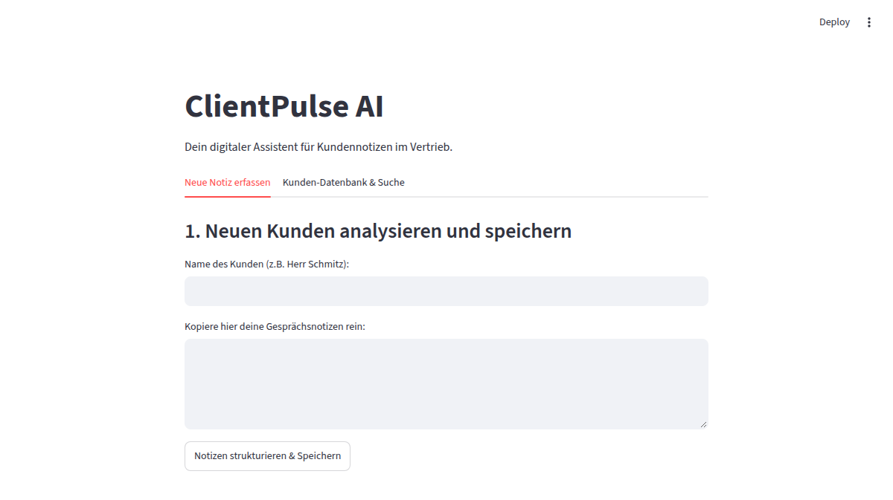

# ClientPulse AI

Kleine Web-App für Außendienst und Vertrieb: Gesprächsnotizen einfügen, die KI macht daraus eine strukturierte Kundenkarte – und alles landet durchsuchbar in einer lokalen Datenbank.

Entstanden für einen Bekannten im Versicherungsvertrieb.



## Was die App macht

Aus freien Notizen wie *„Hat einen Hund, war gerade in Italien, überlegt Lebensversicherung, nächste Woche nochmal anrufen“* erzeugt die KI:

1. **Produktinteresse**
2. **Nächster Schritt**
3. **Soft Facts** (Hobbys, Urlaub, Familie)
4. **Icebreaker** – ein freundlicher Einstiegssatz für das nächste Gespräch

Im zweiten Reiter lassen sich alle gespeicherten Kunden nach Namen durchsuchen.

## Technik

- Python, [Streamlit](https://streamlit.io) für die Oberfläche
- OpenAI API (Chat Completions) für die Auswertung
- SQLite als lokale Datenbank, parametrisierte Abfragen
- API-Schlüssel nur über `.env`, nie im Code

## Starten

```bash
python3 -m venv venv
source venv/bin/activate
pip install -r requirements.txt

cp .env.example .env      # eigenen OpenAI-Schlüssel eintragen
streamlit run app.py
```

## Datenschutz

Die App verarbeitet personenbezogene Daten. Für einen echten Einsatz gilt:

- Kunden vorher informieren und – bei sensiblen Angaben – um Einwilligung bitten.
- Nur Notizen ohne Namen an die KI schicken (der Name bleibt lokal in der Datenbank).
- Anbieter mit Auftragsverarbeitungsvertrag und möglichst EU-Datenverarbeitung wählen, oder ein lokales Sprachmodell nutzen.
- Die Datenbank (`*.db`) gehört nicht ins Repository – sie steht deshalb in `.gitignore`.

## Ideen für später

- Namen automatisch entfernen, bevor Notizen an die KI gehen
- Erinnerungen für den „nächsten Schritt“
- Export als CSV
